# Prompts de modernización — de los Markdown de Wynxx a una aplicación moderna con OpenSpec

> **Taller:** *Legacy Transform Lab — Modernización inteligente de sistemas críticos con IA* · GFT para Credicorp
> **Esta carpeta es una metodología ejecutable**: 16 prompts autocontenidos, pensados para que un agente de desarrollo asistido por IA (p. ej. Claude Code) los ejecute **uno a uno**, con puntos de aprobación humana entre fases.

```
COBOL LEGACY → WYNXX LEGACY TRANSFORMER → descubrimiento de reglas y dominios → ARTEFACTOS MARKDOWN
   → OPENSPEC → especificaciones funcionales y técnicas → ARQUITECTURA MODERNA
   → DESARROLLO ASISTIDO POR IA → VALIDACIÓN DE EQUIVALENCIA FUNCIONAL → APLICACIÓN MODERNIZADA
```

---

## 1. Objetivo de la modernización

**No es traducir COBOL a otro lenguaje.** Es reconstruir la aplicación **respetando su comportamiento** (reglas, validaciones, cálculos, procesos, estados, errores de negocio, integridad de datos) sobre una arquitectura moderna, modular, mantenible y escalable, y **demostrar con evidencia** qué se conserva.

Principios de la metodología:

| Principio | Qué significa en la práctica |
|---|---|
| Evidencia antes que opinión | Todo hecho cita su artefacto de Wynxx (y el código que Wynxx cite) |
| No inventar | Lo que falta es un **vacío registrado** (`GAP-`), no una suposición |
| Especificar antes de implementar | Nada se codifica sin requisito OpenSpec aprobado |
| Decisiones humanas | Arquitectura, tecnología y cambios de comportamiento se aprueban explícitamente |
| Equivalencia graduada | Niveles E0–E3; solo E3 permite hablar de equivalencia demostrada |
| Incrementos verificables | Piloto → dominio a dominio, nunca «todo de una vez» |

---

## Modo taller (90 minutos): el camino que sigue cada participante

1. **Escuchas el discurso** de análisis de dominios y de las reglas de negocio que entrega Wynxx.
2. **Descargas de Wynxx los artefactos de UN dominio** (sus reglas de negocio y su análisis) y los colocas en `wynxx/`.
3. **Ejecutas los prompts en orden** con el agente: `01` analiza *ese* dominio → `02` reconstruye su comportamiento (un **recorte** demostrable) → `03` **aplica la arquitectura común** → `04` modelo corto → `05` especificación OpenSpec → `06` contratos → `09` datos → `07` backend → `08` frontend → `16` **levantas todo en localhost**.
4. **Resultado:** el **backend Java 21 corriendo** y el **frontend React (micro-frontend) corriendo**, mostrando funcionando ese pedazo de dominio contra una base de datos pequeña en contenedor. Los dominios vecinos pueden simularse (opcional, prioridad baja).

**Todos construyen sobre la misma arquitectura** (ver `anexos/A1_ADR_COMUNES.md`): microservicios; backend Java 21 con Clean Architecture; frontend React como micro-frontend con Clean Architecture; contratos OpenAPI; PostgreSQL en contenedor; Docker.

**Kit y guías (`anexos/`)**: `A1` ADR comunes · `A2` convenciones de backend · `A3` convenciones de frontend · `A4` formato de contratos · `A5` kit base, ruta y presupuesto de tiempo. Facilitación construye y verifica el kit con `facilitadores/K0_CONSTRUIR_KIT_BASE.md` **antes** del taller.

Las fases `10`–`15` son **extensión** (después del taller o si sobra tiempo). La variante *exploratoria* del prompt 03 (para proyectos sin arquitectura predefinida) está en `alternativas/`.

---

## 2. Relación entre Wynxx y OpenSpec

| | **Wynxx Legacy Transformer** | **OpenSpec** |
|---|---|---|
| Rol | *Descubre* qué hace el legado | *Gobierna* qué se va a construir |
| Entrega | Markdown: inventario, dependencias, dominios, reglas, procesos, entidades, hallazgos | Specs de comportamiento, propuestas, diseños y tareas por *change* |
| Pregunta que responde | «¿Qué hay y cómo se relaciona?» | «¿Qué debe hacer el sistema nuevo y cómo sabremos que está bien?» |
| Se conecta mediante | `WXI-…` (hechos de Wynxx) → `BR-…` (reglas) | `BR-…` → `Requirement` → tareas → pruebas |

**Wynxx es la fuente; OpenSpec es el contrato; el agente es el ejecutor; los humanos aprueban.**

---

## 3. Requisitos previos

1. **OpenSpec instalado.** Esta metodología se verificó con **OpenSpec 1.16.0** (`openspec --version`).
2. **Inicializado en la raíz del repositorio** (lo hace el prompt 01 con tu confirmación; no se crean archivos de `openspec/` a mano):
   ```bash
   openspec init --tools claude     # la lista de herramientas válidas: openspec init --help
   ```
   Crea `openspec/config.yaml` (esquema `spec-driven`: proposal → specs → design → tasks), `openspec/specs/`, `openspec/changes/` y, para Claude Code, los comandos `/opsx:propose`, `/opsx:explore`, `/opsx:apply`, `/opsx:sync`, `/opsx:update`, `/opsx:archive`. Flujos adicionales (`new`, `continue`, `ff`, `verify`, `bulk-archive`, `onboard`) se activan con `openspec config profile`. **Con otra herramienta, los nombres pueden variar: confírmalos tras `openspec init`.**
3. **Artefactos de Wynxx** copiados en `wynxx/` (en la raíz del espacio de trabajo). En el taller son los del **dominio asignado**. Los prompts no los buscan en otro sitio.
3b. **Herramientas del kit:** Java 21, Node.js LTS, Git y, preferiblemente, Docker (hay alternativa sin Docker). El kit base se entrega ya construido por facilitación.
4. Un agente de desarrollo con acceso al repositorio (lectura/escritura de archivos y ejecución de comandos).

Comandos reales de OpenSpec 1.16 que usa esta metodología:

| Comando | Para qué |
|---|---|
| `openspec new change <nombre>` | Crear un change (kebab-case) |
| `openspec status --change <nombre>` / `--all` | Ver artefactos completados |
| `openspec instructions <artefacto> --change <nombre>` | Instrucciones oficiales de cada artefacto |
| `openspec validate <nombre> --strict` / `--all` | Validar changes y specs |
| `openspec list` / `--specs` / `--all` | Listar changes / specs |
| `openspec show <nombre>` | Ver un change o spec |
| `openspec archive <nombre>` | Archivar y fusionar deltas en `openspec/specs/` |

Formato de especificación (lo exige OpenSpec): `## Purpose` (capacidad nueva), `## ADDED Requirements`, `### Requirement: <nombre>` con SHALL/MUST (≤500 caracteres), y `#### Scenario: <nombre>` con **exactamente 4 `#`**, con `WHEN`/`THEN`.

---

## 4. Estructura de carpetas

```
<raíz del repositorio>
├── (sin código COBOL: la fuente de verdad son los artefactos de Wynxx)
├── wynxx/                    ← artefactos Markdown de Wynxx (entrada)
├── prompts/                  ← esta metodología
├── openspec/                 ← specs y changes (lo gestiona OpenSpec)
└── modernizacion/            ← documentos de trabajo y evidencias
    ├── ESTADO.md             ← estado de cada fase (clave para continuar)
    ├── aprobaciones.md       ← aprobaciones, desviaciones (DESV) y firmas
    ├── trazabilidad/         ← matriz-trazabilidad.md / .csv
    ├── 01-analisis/ … 16-ejecucion-local/ … 15-validacion-final/
```

### Plantilla de `modernizacion/ESTADO.md` (la crea el prompt 01)

```markdown
# Estado de la modernización
Última actualización: <fecha> · Agente/operador: <nombre>

| Fase | Estado | Aprobada por / fecha | Entregables | Changes OpenSpec | Notas |
|---|---|---|---|---|---|
| 01 Análisis artefactos Wynxx | No iniciada |  |  |  |  |
| 02 Reconstrucción funcional  | No iniciada |  |  |  |  |
| … (una fila por fase 01–16)  |  |  |  |  |  |

Estados: No iniciada · En curso · Completada, pendiente de aprobación · Aprobada · Bloqueada · Omitida (con motivo)

## Vacíos / contradicciones abiertos (resumen)   → detalle en 01-analisis/vacios-y-contradicciones.md
## Decisiones pendientes (ADR / DESV)             → detalle en 03-arquitectura/adr y aprobaciones.md
## Próxima acción recomendada
```

---

## 5. Orden de ejecución, entradas y resultados

> **El número del archivo identifica la fase; el orden de ejecución recomendado tiene dos excepciones:** `09` (datos) va antes de `07` (backend) porque el modelo de datos condiciona la implementación, y `16` (ejecución local) va después de `10` y **antes de `11`**, porque primero hay que ver el dominio funcionando para validarlo.

**Orden:** `01 → 02 → 03 → 04 → 05 → 06 → 09 → 07 → 08 → 10 → 16 → 11 → 12 → 13 → 14 → 15`

| # | Prompt | Entradas principales | Resultado | ¿Compuerta humana? |
|---|---|---|---|---|
| 01 | `01_ANALISIS_ARTEFACTOS_WYNXX` | `wynxx/*.md` (del dominio asignado) | Catálogo, hechos, vacíos/contradicciones, matriz v0, OpenSpec listo | Sí |
| 02 | `02_RECONSTRUCCION_FUNCIONAL` | Salidas de 01 | Reglas `BR-`, cálculos, procesos, estados, rarezas | Sí (negocio) |
| 03 | `03_ARQUITECTURA_OBJETIVO` | 01, 02 | Contraste de la arquitectura de referencia, arquitectura de sistema/backend/frontend, contenerización, nube, topología local, **ADR propuestos** | **Sí (ADR)** |
| 04 | `04_MODELADO_DOMINIOS_DDD` | 01–03 | Contextos, lenguaje ubicuo, mapa, **dominios piloto** | Sí |
| 05 | `05_ESPECIFICACIONES_OPENSPEC` | 02–04 | Change(s): proposal + specs + design + tasks validados | **Sí (antes de implementar)** |
| 06 | `06_DISENO_CONTRATOS_APIS` | 04, 05, ADR | Contratos, eventos, catálogo de errores | Sí |
| 09 | `09_PERSISTENCIA_DATOS` | DB2/VSAM/copybooks, 04–06 | Modelo de datos, mapeo, migración, conciliación | Sí |
| 07 | `07_IMPLEMENTACION_BACKEND` | Change aprobado, 06, 09, ADR | Código + pruebas por incremento (`/opsx:apply`) | Por incremento |
| 08 | `08_IMPLEMENTACION_FRONTEND` | BMS/CICS en alcance, 05–07 | Interfaz equivalente (omitir si no aplica) | — |
| 10 | `10_INTEGRACION_DOMINIOS` | Contextos implementados, 06 | Integraciones y procesos extremo a extremo | — |
| 16 | `16_EJECUCION_LOCAL_VERIFICACION` | Topología local (03), 07–10, ADR de contenerización | **Entorno local de un comando**: backend + frontend + datos + dobles, con smoke tests y evidencia real | — |
| 11 | `11_VALIDACION_REGLAS_NEGOCIO` | 02, 07–10 | Matriz regla→prueba, veredicto con nivel de evidencia | Sí (diferencias) |
| 12 | `12_PRUEBAS_FUNCIONALES` | Specs, 06, 10, 11 | Suite automatizada + regresión + informe real | — |
| 13 | `13_OBSERVABILIDAD_SEGURIDAD` | Controles del legado, ADR | Auditoría, seguridad, métricas, cumplimiento | Sí |
| 14 | `14_DESPLIEGUE_CLOUD_NATIVE` | ADR, código, batch | Pipeline, IaC, batch, migración, reversa | **Sí (plataforma)** |
| 15 | `15_VALIDACION_FINAL_MODERNIZACION` | Todo | Informe final, declaración de equivalencia, resumen ejecutivo | Sí (comité) |

### Dependencias entre fases

```mermaid
flowchart LR
  F01[01 Análisis Wynxx] --> F02[02 Funcional] --> F03[03 Arquitectura] --> F04[04 Dominios DDD] --> F05[05 Specs OpenSpec]
  F05 --> F06[06 Contratos] --> F09[09 Datos] --> F07[07 Backend]
  F07 --> F08[08 Frontend]
  F07 --> F10[10 Integración]
  F08 --> F10
  F10 --> F16[16 Ejecución local] --> F11[11 Validación reglas] --> F12[12 Pruebas] --> F13[13 Seguridad/Obs.] --> F14[14 Despliegue] --> F15[15 Validación final]
```



**Dos ciclos:** las fases **01–04 se hacen una vez** para todo el sistema. Las fases **05–15 se repiten por dominio piloto e incremento**; luego se continúa con el backlog de dominios (definido en la fase 04).

**Estrategia para el taller (tiempo limitado):** camino corto `01 → 02 → 03 → 04 → 05 → 06 → 09 → 07 → 08 → 16` sobre **el dominio asignado** (un recorte vertical), con las fases `10`–`15` como extensión. Es preferible un recorte bien demostrado, con backend y frontend corriendo, a una cobertura superficial. Presupuesto de tiempo y plan B en `anexos/A5_KIT_LOCAL_Y_RUTA.md`.

---

### Arquitectura de referencia del taller (se refina en el prompt 03)

El prompt 03 parte de una **referencia** que debe contrastarse con la evidencia del legado, no aceptarse a ciegas:

| Capa | Referencia (hipótesis) | Qué debe demostrar el prompt 03 |
|---|---|---|
| Sistema | Microservicios, uno por contexto acotado | Qué contextos justifican servicio propio y cuáles deben vivir juntos (p. ej. por atomicidad) |
| Backend (por servicio) | Clean Architecture (dominio · casos de uso · adaptadores · infraestructura) | Regla de dependencia y pruebas de arquitectura verificables |
| Frontend | Micro-frontends (shell + piezas por dominio) | Si la cantidad y variedad de pantallas del legado lo justifica; si no, alternativa modular |
| Contenerización | Docker (una imagen por servicio y por micro-frontend) | Estrategia de imágenes y composición local |
| Plataforma | Nube / cloud-native | Principios y criterios de selección, **sin elegir proveedor** |

Cada elemento termina como **ADR propuesto** (Adoptar / Adoptar con ajustes / Posponer / Descartar) y requiere aprobación humana.

---

## 6. Cómo ejecutar un prompt

1. Abre el agente en la **raíz del repositorio**.
2. Entrega el contenido del prompt (o referencia el archivo, p. ej. `@prompts/01_ANALISIS_ARTEFACTOS_WYNXX.md`).
3. El agente lee `modernizacion/ESTADO.md`, comprueba que la fase previa está **Aprobada** y ejecuta.
4. Al terminar, el agente actualiza `ESTADO.md` y entrega **«Para aprobar»**.
5. **Un humano revisa y registra la aprobación** en `modernizacion/aprobaciones.md` y pone la fase en *Aprobada* en `ESTADO.md`.
6. Se pasa al siguiente prompt.

Cada prompt trae las mismas secciones: *Contexto · Objetivo · Entradas · Instrucciones · Uso de OpenSpec · Entregables · Criterios de aceptación · Trazabilidad · Restricciones*, más *Punto de aprobación* cuando corresponde.

---

## 7. Trazabilidad y evidencia

**Cadena obligatoria:**
`Artefactos Wynxx → Reglas de negocio → Especificaciones OpenSpec → Componentes modernizados → Pruebas de equivalencia funcional`
(el código COBOL es el origen de los artefactos de Wynxx, pero **no se consulta directamente** en esta metodología)

**IDs**

| ID | Significa |
|---|---|
| `WXI-<doc>-<nnn>` | Hecho extraído de un artefacto Wynxx |
| `COB:<archivo>:<línea>` | Referencia al código **citada por Wynxx** (solo si el artefacto la cita) |
| `BR-<dominio>-<nnn>` | Regla de negocio normalizada (nace en la fase 02) |
| `GAP-` / `CON-` / `AMB-` | Vacío / contradicción / ambigüedad |
| `DESV-` | Desviación de comportamiento (requiere aprobación) |
| `ADR-` | Decisión de arquitectura |
| `DIF-` | Diferencia detectada en la validación |

> Los identificadores `RN-XXX-NN` que Wynxx cite desde el código son evidencia legada; se mapean a `BR-` en la fase 02.

**Niveles de evidencia de equivalencia**

| Nivel | Definición |
|---|---|
| **E0** | Declarado en un solo artefacto de Wynxx |
| **E1** | Corroborado: coincide en ≥2 artefactos de Wynxx, o el artefacto cita el código que lo respalda |
| **E2** | Caso derivado de la regla documentada (cálculo manual o script) sin ejecutar el legado |
| **E3** | Contrastado con ejecución real del legado o dataset de regresión aportado |

**La equivalencia completa no se declara sin E3** con muestra descrita. Sin el COBOL ni salidas reales del legado, el nivel máximo alcanzable es **E2**.

La **matriz de trazabilidad** (`modernizacion/trazabilidad/matriz-trazabilidad.md/.csv`) nace en 01 y cada fase completa columnas: `ID-Wynxx | Tipo | Dominio | Referencia-código | Nivel | Estado | BR | Spec-OpenSpec | Contrato | Dato | Componente | Prueba | Resultado`.

---

## 8. Cómo verificar el avance

```bash
openspec list --json            # changes activos
openspec list --specs           # specs principales
openspec status --all           # artefactos completados por change
openspec validate --all --strict
```
Y en `modernizacion/`:
- `ESTADO.md` (fases y estados) y `aprobaciones.md` (quién aprobó qué).
- `trazabilidad/matriz-trazabilidad.csv`: porcentaje de filas con `BR`, `Spec`, `Componente` y `Prueba` completos.
- `01-analisis/vacios-y-contradicciones.md`: abiertos vs. resueltos.

## 9. Cómo continuar desde una ejecución anterior

1. Lee `modernizacion/ESTADO.md` → primera fase que no esté *Aprobada*.
2. Ejecuta `openspec list --json` y `openspec status --all` para ver changes y tareas.
3. Revisa el apartado *Próxima acción recomendada* y los vacíos/decisiones abiertos.
4. Si una fase quedó *En curso*, re-ejecuta su prompt: está diseñado para **no rehacer** lo ya entregado (cada prompt verifica sus entregables existentes antes de crear nuevos).
5. Si cambian los artefactos de Wynxx, vuelve a 01 (delta) y propaga el impacto con la matriz de trazabilidad.

## 10. Qué NO hace esta metodología

- No usa ni modifica el código COBOL (no forma parte del espacio de trabajo).
- No adopta la arquitectura de referencia sin evidencia ni la descarta sin ella: se contrasta, se refina y la decide el equipo con ADR. Tampoco elige lenguaje, frameworks ni proveedor de nube.
- No genera la aplicación completa de una vez.
- No declara equivalencia sin evidencia suficiente.

## 11. Notas para facilitadores

- Los **artefactos de Wynxx** deben corresponder a la **misma versión del repositorio** que se modernizará; mezclar análisis de versiones distintas genera contradicciones (el prompt 01 las detecta).
- En el repositorio de entrenamiento existe `docs-taller/dominios/*.md` (casos de prueba de referencia, calculados con script, **no ejecutando COBOL**). Es un **oráculo de facilitadores** (nivel E2); úsalo solo si lo autorizas para la fase 11 y no lo entregues como si fuera salida de Wynxx.
- Los *puntos de aprobación* son parte de la demostración: muestran cómo se gobierna la IA, no cómo se frena.
